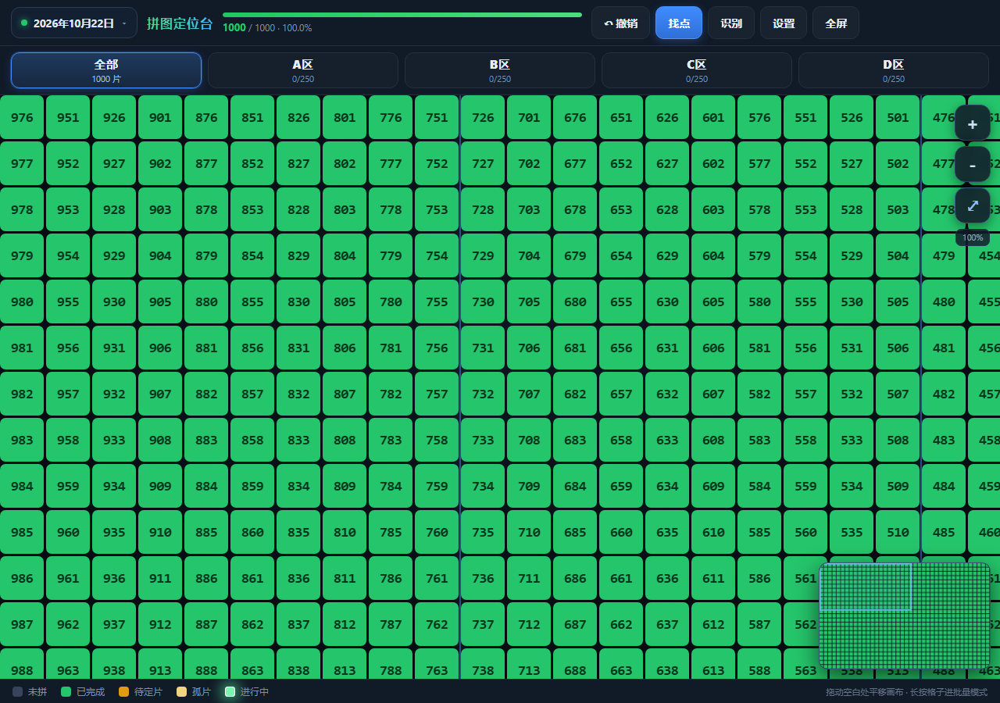
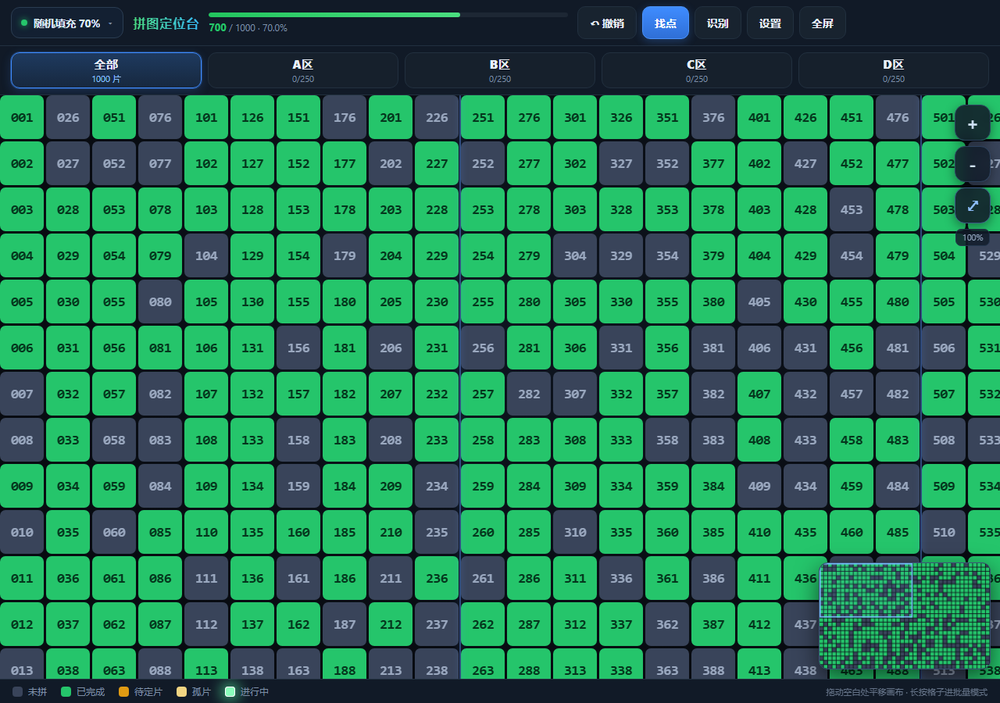
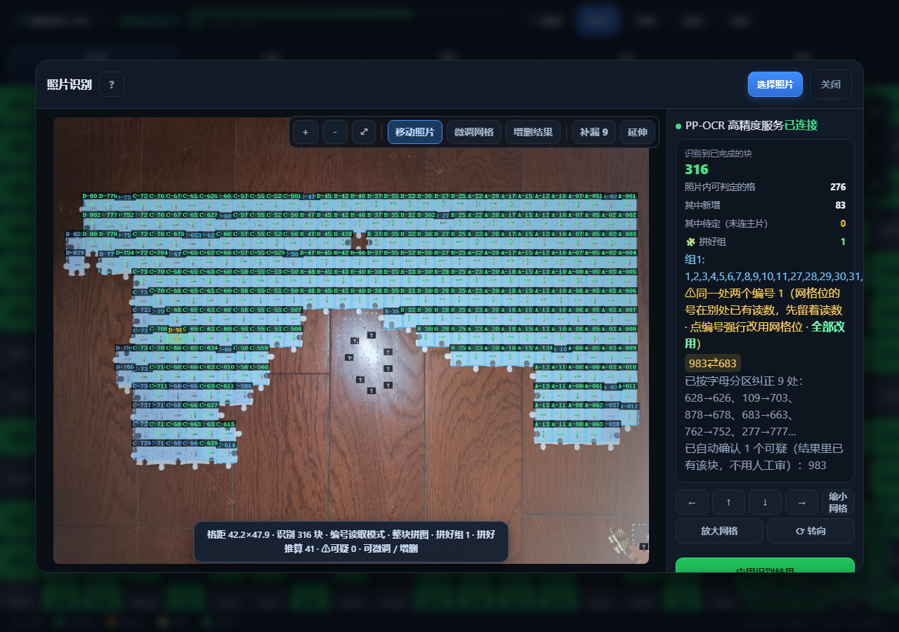
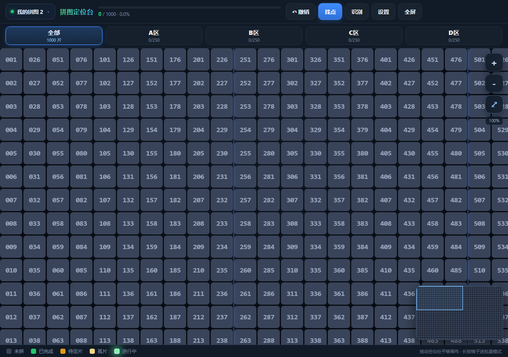

# 拼图定位台（Puzzle Resolver）

局域网多人实时同步的拼图定位与进度看板，触摸屏优先。专为「照片拼图背面印着编号」的实物拼图设计：
在电脑/平板上开一个看板，对着照片自动识别每片的编号与摆放位置，家人朋友各拿一台设备在同一张图上实时标记进度。

<p align="center">
  
  
  
  
</p>

## 功能

- **大容量网格看板**：默认 1000 片 / 40 列，总数、列数、分区大小、行列顺序、起点角均可配置；A/B/C/D 分区页签快速过滤。
- **五态进度标记**：未拼（灰）/ 已完成（绿）/ 进行中（绿闪）/ 待定片（黄）/ 孤片（浅黄），点击循环切换；待定片与其他片连成整体后自动晋升为已完成。支持撤销。
- **找点与引导**：按编号一键定位并聚焦缩放；引导模式按「整组一起放、独立片贴着已拼区生长」的两级顺序逐片引导，配合小窗预览高亮当前这一步。
- **局域网实时同步**：同一张图即一个房间，多台设备打开同一地址加入，改动即时互相同步（WebSocket）。
- **照片 OCR 自动识别（可选）**：把拼图背面的照片拖进「识别」页，自动检出每片的编号读数并回填棋盘；带可疑读数人工审核、漏读补点、邻片推算延伸、换号/改号等一整套收尾工具。
- **标注台**：独立的照片标注小工具（`label/`），用于维护 OCR 字形模板与人工校对标注。

## 快速开始

环境要求：**Node.js ≥ 18**。OCR 高精度服务为可选项，见下文。

```bash
npm install

# 开发模式：Express + Vite 中间件（HMR 走 8850 端口）
npm run dev          # → http://127.0.0.1:8848/

# 生产模式：先构建前端，再由 Express 托管 dist/
npm run build
npm start
```

Windows 下也可以直接双击 **`start-lan-server.bat`**：自动构建（首次）、起服务、清理被占用的端口。

启动后控制台会打印本机和局域网访问地址，其他设备（手机/平板）连同一 Wi-Fi 打开地址即可，多设备间自动实时同步。

## OCR 高精度识别（可选）

「识别」页默认使用**内置模板匹配**（纯前端，无任何依赖）。若本机装有 Python + [RapidOCR](https://github.com/RapidAI/RapidOCR)，Node 服务会自动把 `label/ocr_server.py` 作为子进程拉起（端口 8849），并通过 `/ocrsvc/*` 同源代理给页面，识别精度和鲁棒性显著更好：

```bash
pip install rapidocr_onnxruntime
```

- 服务端启动时探测 8849：已在运行则复用，没在运行且装了 RapidOCR 则自动拉起，挂掉自动重启。
- 没装 Python 也不影响其他功能，只是 OCR 走内置模板。
- 端口约定：**8848** 页面/同步、**8849** PP-OCR、**8850** 开发模式 HMR。

## 目录结构

```
├── index.html              前端唯一入口（Vite）
├── src/frontend/           前端模块：board 看板 / scan 识别 / guide 引导 /
│                           sync 同步 / coords 编号网格 / settings 等
├── server/                 Node 服务：index 服务入口 / ws 房间同步 /
│                           store 进度落库 / ocr PP-OCR 子进程代管
├── label/                  标注台（双击 index.html 即用）+ ocr_server.py + 字形模板
├── study/                  OCR 模板与候选集的离线构建管线（Python）
├── public/                 案例照片（85889~85892.jpg，可拖进「识别」页体验）
├── docs/screenshots/       README 截图
├── puzzle-map.html         v8 旧版单文件实现（遗留备查）
└── server.js               v8 旧版服务（遗留备查）
```

## 数据

拼图进度实时落盘到项目根目录的 `puzzle-data.json`（首次启动自动创建，已在 `.gitignore` 中排除）。所有数据只存在本机，不经任何第三方转发；README 中的截图为演示数据。

## License

[MIT](LICENSE)
